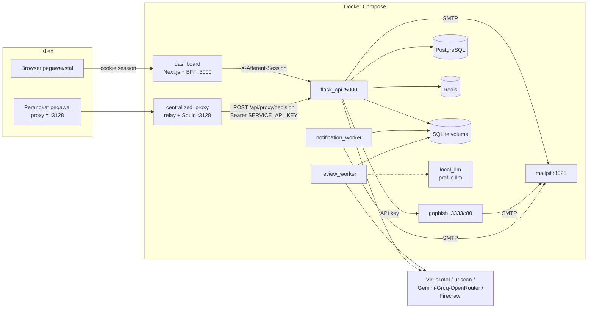
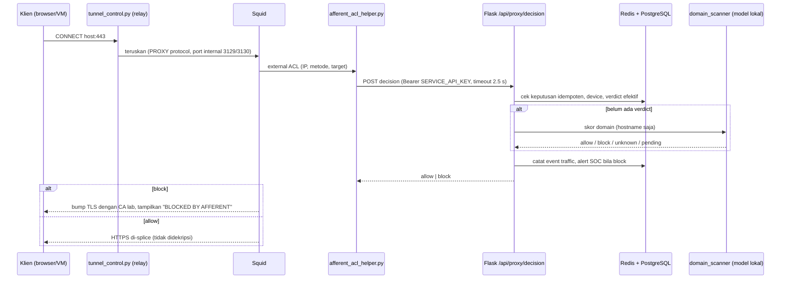

# Arsitektur AFFERENT

Dokumen ini untuk developer baru. Semua klaim diturunkan dari kode di repo pada commit `c6bd8ef`;
yang tidak bisa dipastikan ditandai `TODO: konfirmasi ke tim`.

AFFERENT (nama repo/remote: *Afferent_Internal* di organisasi Afferent-id; sebelumnya *Human_Firewall*) adalah platform lab/demo (target 5–8 pengguna, bukan
produksi publik) untuk awareness phishing, pelaporan karyawan, dan pemantauan traffic lewat proxy
terpusat yang dikendalikan SOC. Lihat batas klaim di [README](../README.md).

## 1. Komponen

| Komponen | Teknologi | Peran | Folder |
| --- | --- | --- | --- |
| Dashboard + BFF | Next.js 16 / React 19 (App Router) | UI semua role; route `/api/*` meneruskan request ke Flask dengan session | [dashboard/](../dashboard/) |
| Backend API | Flask 3 + gunicorn (gthread) | Auth/OTP/RBAC, telemetri, laporan, kampanye, keputusan proxy | [backend/](../backend/) |
| Worker notifikasi | Python (image backend yang sama) | Menguras outbox email, cek edukasi untuk skor rendah | [backend/notification_worker.py](../backend/notification_worker.py) |
| Worker review | Python (image backend yang sama) | Scan file privat (VirusTotal) dan review LLM lokal | [backend/review_worker.py](../backend/review_worker.py) |
| Proxy terpusat | Squid (ssl-bump) + relay TCP Python | Menegakkan kebijakan domain per koneksi | [proxy/](../proxy/) |
| GoPhish | GoPhish (image sendiri) | Mesin simulasi phishing | [gophish/](../gophish/) |
| Mailpit | `axllent/mailpit` | Menangkap semua email (OTP, edukasi, kampanye); tidak ada SMTP nyata | `docker-compose.yml` |
| PostgreSQL 17 | `proxy_postgres` | Traffic proxy, verdict, alert SOC, audit proxy | `docker-compose.yml` |
| Redis 7 | `proxy_redis` | Cache verdict, lock scan, transport event live (SSE) | `docker-compose.yml` |
| SQLite | file `human_firewall.db` (volume `flask_db`) | Akun, session, telemetri phishing, kuis, gamifikasi, laporan, outbox email | [backend/database.py](../backend/database.py) |
| Ollama (opsional) | profile Compose `llm` | Saran hostname untuk SOC (advisory saja) | [ml/local_llm/](../ml/local_llm/) |

Dua penyimpanan data berjalan berdampingan **sengaja**: SQLite untuk data aplikasi "lama", PostgreSQL+Redis
untuk data plane proxy (lihat komentar di [backend/app.py](../backend/app.py)).
`TODO: konfirmasi ke tim` apakah SQLite akan dimigrasi ke PostgreSQL.

Port default (semua terikat ke `127.0.0.1` kecuali env `*_BIND_IP` diubah): dashboard 3000, Flask 5000,
GoPhish admin 3333, GoPhish phish server 8080→80, Mailpit UI 8025, proxy 3128.

## 2. Diagram komponen



## 3. Alur data end-to-end

### 3.1 Login (email + password + OTP)

```mermaid
sequenceDiagram
    participant U as Pengguna
    participant N as Next.js (/auth, BFF)
    participant F as Flask (routes/auth.py)
    participant S as auth_service (SQLite)
    participant M as Mailpit
    U->>N: POST /api/auth/login (email, password)
    N->>F: forward
    F->>S: verifikasi password (argon2) + buat challenge OTP
    S->>M: kirim OTP via SMTP
    U->>N: POST /api/auth/verify-otp
    N->>F: forward
    F->>S: verifikasi OTP, buat auth_session (TTL 24 jam)
    F-->>N: token session opak
    N-->>U: Set-Cookie (nama di lib/authSession.ts)
    Note over N,F: Request berikutnya: BFF mengirim X-Afferent-Session;<br/>Flask memuat identitas+role dari DB
```

Dasar: [routes/auth.py](../backend/routes/auth.py), [services/auth_service.py](../backend/services/auth_service.py),
[dashboard/src/lib/backendClient.ts](../dashboard/src/lib/backendClient.ts), [docs/PHASE1_EMAIL_OTP.md](PHASE1_EMAIL_OTP.md).

### 3.2 Keputusan proxy (jalur panas)



Aturan yang terbaca dari [services/proxy_service.py](../backend/services/proxy_service.py) (`decide`, `_decide_unknown`):

- Verdict SOC manual selalu didahulukan atas ML.
- Verdict ML yang sah "Unknown" → diizinkan untuk direview SOC.
- Model belum siap / timeout (`pending`/`unavailable`) → **diblok sementara**, tidak disimpan sebagai verdict jahat.
- `PROXY_FAIL_MODE=closed` (default): bila backend tidak terjangkau, helper memblok.
- Tunnel aktif direkonsiliasi dengan kebijakan terbaru (`PROXY_REVOCATION_INTERVAL_SECONDS`).

Sumber: [proxy/squid.conf](../proxy/squid.conf), [proxy/afferent_acl_helper.py](../proxy/afferent_acl_helper.py),
[proxy/tunnel_control.py](../proxy/tunnel_control.py), [docs/CENTRALIZED_PROXY.md](CENTRALIZED_PROXY.md).

### 3.3 Simulasi phishing → telemetri → gamifikasi

1. `phishing_admin` membuat template/landing page/kampanye lewat Wizard di dashboard
   → `/api/admin/gophish/*` (BFF) → [routes/admin_api.py](../backend/routes/admin_api.py) → [gophish_client.py](../backend/gophish_client.py) → GoPhish.
2. GoPhish mengirim email ke Mailpit; pegawai mengklik. Event disinkronkan (`GOPHISH_SYNC_ENABLED`) dan/atau masuk
   lewat `redirect-handler`/`fake-login-submit` di [routes/events.py](../backend/routes/events.py).
3. Event disimpan di SQLite (`events`, `gophish_event_receipts`, `simulation_campaigns`), tier pegawai dihitung
   (`classify_tier` di [database.py](../backend/database.py)), skor 0–200 dan badge di [gamification_routes.py](../backend/gamification_routes.py).
4. `notification_worker` memeriksa pegawai aktif di bawah ambang (`EDUCATION_SCORE_THRESHOLD`, default 60) dan
   memasukkan email edukasi ke outbox; default **manual approval** (`EDUCATION_AUTO_ENABLED=false`).

### 3.4 Scan URL / file / laporan pegawai

- URL & laporan link: VirusTotal + urlscan (bukan model proxy) → `threat_service`/`report_service`; laporan link muncul di Security Inbox SOC/GRC.
- File privat: unggah → job di SQLite → `review_worker` memanggil VirusTotal; tidak membuat laporan SOC maupun skor.
- Kuota VT dibagi API + worker lewat `VT_REQUESTS_PER_MINUTE`.
- Tanpa API key hasilnya "Unknown" (disengaja).

## 4. Akses per role

Role valid (`VALID_ROLES` di [auth_service.py](../backend/services/auth_service.py)): `employee`, `phishing_admin`, `soc`, `grc`, `ciso`.
Penegakan: decorator `require_roles(...)` di [security.py](../backend/security.py) (role diambil dari session di DB, bukan dari header/body),
plus gerbang deny-by-default `before_request` di [app.py](../backend/app.py) (daftar `PUBLIC_ROUTES`).
Di sisi Next.js, [src/proxy.ts](../dashboard/src/proxy.ts) hanya mengecek **keberadaan** cookie; otorisasi sebenarnya ada di Flask.

| Role | Halaman utama (dashboard) | Hak utama di backend |
| --- | --- | --- |
| `employee` | `/` (home, kuis harian, Spot the Fake, scanner URL, koneksi proxy), `/settings`, `/blocked` | Laporan & scan sendiri, kuis, registrasi/heartbeat perangkat proxy, ajukan access request |
| `phishing_admin` | `/dashboard/phishing-admin` | Hampir semua `/api/admin/gophish/*`, karyawan & divisi, template/page, AI generate kampanye |
| `soc` | `/dashboard/soc` | Alert/verdict/traffic/audit proxy, keputusan manual Block/Allow, incident, security inbox, access request, second opinion LLM |
| `grc` | `/dashboard/grc` | Compliance summary, readiness threshold, audit log, leaderboard, access request (baca/keputusan sesuai route) |
| `ciso` | `/dashboard/ciso` | Ringkasan eksekutif, tren, posture, laporan PDF, sebagian view proxy |

Matriks di atas diringkas dari pemakaian `@require_roles(...)` per route; rincian per endpoint ada di kode
([routes/](../backend/routes/)). `TODO: konfirmasi ke tim` untuk matriks hak akses resmi (belum ada dokumen RBAC di luar `archive/`).

Jalur akses lain:

- **Service-to-service**: header `Authorization: Bearer <SERVICE_API_KEY>` (dipakai ACL helper Squid dan proses internal); `allow_service=True` pada route tertentu.
- **Publik** (tanpa session, token/validasi sendiri): `/health`, `/api/auth/login|verify-otp|resend-otp|logout`, `redirect-handler`, `fake-login-submit`, `/api/event`, `/api/user-profile`, `/blocked`, `/api/proxy/ml/verdict` (HMAC `ML_WEBHOOK_SECRET`), `/api/proxy/ca.crt`.
- **Mode mock front-end** (`npm run dev:mock`): tanpa backend; hanya aktif di `next dev` ([src/mocks/](../dashboard/src/mocks/)).
- **Dev bypass** (`DEV_BYPASS_AUTH=true`): hanya berlaku bila `APP_ENV` development/test; Flask menolak boot tidak aman di staging/production.

## 5. Model ML

- **Aktif di proxy**: model domain-saja terkalibrasi `backend/models/domain_v3/` (`joblib`), dimuat lewat [services/domain_scanner.py](../backend/services/domain_scanner.py). Tidak pernah fetch URL atau mengintip TLS.
- **Char-BiLSTM** (`backend/models/char_bilstm.pt`, `calibrators.pkl`): dipakai endpoint `/api/threat/scan-dl` dan `model-status` ([char_bilstm_scanner.py](../backend/char_bilstm_scanner.py)); `TODO: konfirmasi ke tim` apakah masih bagian jalur produk atau eksperimen.
- **LLM lokal** (Ollama, opsional): saran hostname untuk SOC; tidak dapat mem-blacklist otomatis.
- Penyedia AI cloud (Gemini/Groq/OpenRouter) hanya untuk asisten AI/laporan, bukan verdict proxy ([ai_router.py](../backend/ai_router.py)).
- Hasil evaluasi terukur: [DOMAIN_ML_EVALUATION.md](DOMAIN_ML_EVALUATION.md).

## 6. Konfigurasi & rahasia

Lihat [SETUP.md](SETUP.md) untuk daftar env var. `scripts/setup_lab.py` membangkitkan `.env`, `.env.proxy.local`
(rahasia proxy/DB) dan CA lab di `secrets/`; semuanya di-`.gitignore`.
