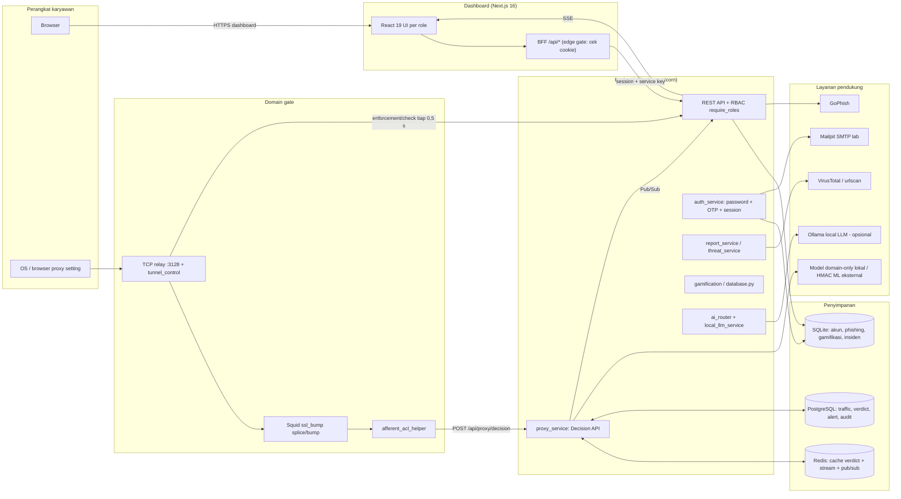
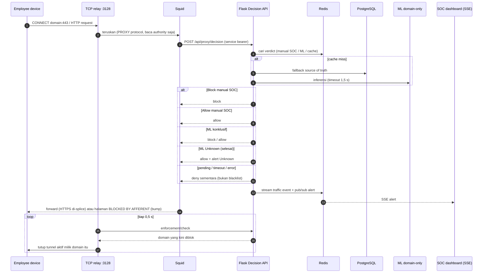
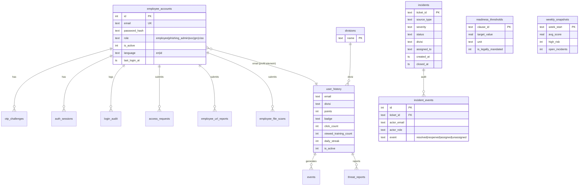
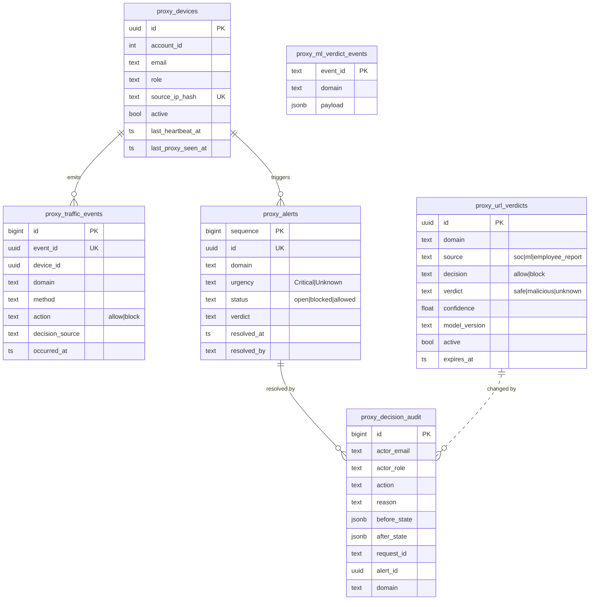

# Afferent — Software Requirements Specification (SRS)

| Item | Nilai |
| --- | --- |
| Produk | Afferent (internal cybersecurity product) |
| Dokumen | SRS v0.1 (draft untuk review tim & mentor) |
| Dokumen pendamping | [PRD.md](PRD.md) |
| Basis | Kode di branch `development` (commit `c6bd8ef`), ditelusuri file per file |

**Konvensi.**

- **FR-xxx** = functional requirement yang **sudah ada** di kode (kolom *Modul* menunjuk file sumbernya).
- **FR-Fxx** = requirement **Future** (belum ada kode; berasal dari masukan mentor/rencana).
- **NFR-xxx** = non-functional requirement. Kolom *Status*: ✔ ditegakkan di kode/konfigurasi, ◐ sebagian, ✘ belum.
- **Prioritas** memakai MoSCoW (M/S/C/W), sama dengan PRD §6.
- Tidak ada kredensial atau data pribadi di dokumen ini; nama variabel environment dicantumkan, nilainya tidak.

---

## 1. Pendahuluan

### 1.1 Tujuan
Menetapkan kebutuhan perangkat lunak Afferent agar tim engineering, QA, GRC, dan mentor memiliki acuan yang dapat ditelusuri ke kode.

### 1.2 Lingkup
Lihat PRD §5. Ringkas: dashboard berbasis role + backend Flask + domain gate (Squid + TCP relay) + simulasi phishing (GoPhish) + modul awareness/gamifikasi + pelaporan kepatuhan. Rilis saat ini adalah **lab/demo 5–8 user**, bukan klaim production-ready.

### 1.3 Definisi
| Istilah | Arti |
| --- | --- |
| BFF | Backend-for-Frontend; route Next.js (`dashboard/src/app/api/*`) yang menjadi satu-satunya pintu browser ke Flask |
| Domain gate | Keputusan allow/block per domain pada proxy, berdasarkan kebijakan SOC + model ML domain-only |
| SSE | Server-Sent Events untuk alert real-time ke dashboard SOC |
| Splice / bump | Squid `splice` meneruskan TLS apa adanya; `bump` mengakhiri TLS lokal (hanya untuk halaman blokir) |
| MTTC | Mean Time to Close insiden (jam) |
| IoC | Indicator of Compromise (di UI: threat cache) |

---

## 2. Gambaran Sistem

### 2.1 Arsitektur logis

Sumber: [docker-compose.yml](../docker-compose.yml), [docs/CENTRALIZED_PROXY.md](CENTRALIZED_PROXY.md), [proxy/squid.conf](../proxy/squid.conf).

### 2.2 Deployment (Docker Compose, 10 service)

| Service | Image/Build | Peran | Port host (default) |
| --- | --- | --- | --- |
| `dashboard` | `./dashboard` | Next.js UI + BFF | 3000 (loopback) |
| `flask_api` | `./backend` | REST API (gunicorn gthread, 1 worker × 16 thread) | 5000 (loopback) |
| `centralized_proxy` | `./proxy` | TCP relay + Squid | 3128 (`PROXY_BIND_IP`) |
| `proxy_postgres` | `postgres:17-alpine` | Source of truth proxy | tidak dipublikasikan |
| `proxy_redis` | `redis:7-alpine` | Hot path + stream + pub/sub (AOF, password) | tidak dipublikasikan |
| `gophish` | `./gophish` | Simulasi phishing | 3333, 8080 (loopback) |
| `mailpit` | pinned digest | SMTP lab (OTP, edukasi) | 8025 (loopback) |
| `notification_worker` | `./backend` | Pengiriman edukasi + sinkronisasi GoPhish | — |
| `review_worker` | `./backend` | Antrian review VirusTotal/local LLM | — |
| `local_llm` | `ollama/ollama` (profil `llm`) | Second opinion hostname (opsional) | tidak dipublikasikan |

Semua service di jaringan bridge `hfl_network`; port database/Redis tidak dipublikasikan.

### 2.3 Alur keputusan domain

### 2.4 Pengguna dan kelas role
Lima role: `employee`, `phishing_admin` (label UI: Administrator), `soc`, `grc`, `ciso`. Rincian jobdesk: PRD §3.

---

## 3. Functional Requirements (Existing)

Kolom *Modul* memetakan ke kode. Prioritas dalam MoSCoW.

### 3.1 Autentikasi, session, dan akun

| ID | Requirement | Modul | Prio |
| --- | --- | --- | :-: |
| FR-001 | Sistem harus mengautentikasi user dengan email + password (hash Argon2) lalu menantang OTP yang dikirim lewat email. | [routes/auth.py](../backend/routes/auth.py), [services/auth_service.py](../backend/services/auth_service.py), [services/email_service.py](../backend/services/email_service.py) | M |
| FR-002 | Sistem harus membatasi OTP: kedaluwarsa (`OTP_EXPIRY_SECONDS`, default 300), maks. percobaan (`OTP_MAX_ATTEMPTS`, 5), cooldown resend (60 s), dan rate limit per jendela (5 per 900 s). OTP disimpan sebagai hash ber-pepper. | auth_service.py, tabel `otp_challenges` | M |
| FR-003 | Sistem harus menerbitkan session opaque berbasis database (token disimpan sebagai hash, terikat hash IP & user-agent) dalam cookie HTTP-only `afferent_session`, TTL default 86400 s, dan dapat dicabut. | auth_service.py, tabel `auth_sessions`, [dashboard/src/lib/authSession.ts](../dashboard/src/lib/authSession.ts) | M |
| FR-004 | Sistem harus mencatat tiap percobaan login/OTP ke `login_audit` (email, event, sukses, alasan, request ID, hash IP) dan menampilkannya sebagai login history untuk Administrator/SOC/CISO. | database.py (`login_audit`), `GET /api/admin/login-history` | S |
| FR-005 | Administrator harus dapat membuat/mengubah akun (role ∈ 5 role valid, divisi, status aktif, reset password) dan membuat divisi. Role di luar himpunan ditolak. | auth_service.py (`create_account`, `update_account`, `VALID_ROLES`), `POST/PUT /api/admin/employees`, `/api/admin/divisions` | M |
| FR-006 | User harus dapat mengganti password; semua session aktif dicabut setelahnya. User dapat memilih bahasa antarmuka (`en`/`id`) per akun. | routes/auth.py (`change-password`, `language`) | S |
| FR-007 | Sistem harus menegakkan RBAC di server pada setiap route non-publik lewat `require_roles`; role tidak pernah dibaca dari input klien. Route tidak terdaftar publik ditolak (deny-by-default) dengan 401. | [security.py](../backend/security.py), `app.before_request` di [app.py](../backend/app.py) | M |
| FR-008 | Sistem harus menolak start bila `SECRET_KEY`, `ADMIN_PASSWORD`, atau `SERVICE_API_KEY` kosong, dan menolak `DEV_BYPASS_AUTH`/`FLASK_DEBUG` bila `APP_ENV` staging/production. | app.py, security.py (`validate_runtime_security`) | M |
| FR-009 | Alur login lama (Telegram/admin token) harus dinonaktifkan dan mengembalikan HTTP 410 `AUTH_FLOW_RETIRED`. | routes/auth.py (`retired_auth_flow`) | S |

### 3.2 Simulasi phishing (GoPhish)

| ID | Requirement | Modul | Prio |
| --- | --- | --- | :-: |
| FR-010 | Administrator harus dapat membuat, mengubah, menghapus template email dan landing page GoPhish, dan mengimpor situs statis (opsional via Firecrawl). | admin_api.py (`/api/admin/gophish/templates|pages|import-site`), [gophish_client.py](../backend/gophish_client.py), [services/campaign_materials.py](../backend/services/campaign_materials.py) | S |
| FR-011 | Administrator harus dapat meluncurkan, menyinkronkan, menyelesaikan, dan menghapus kampanye; penerima dibatasi pada employee aktif terpilih. Kegagalan API GoPhish ditampilkan apa adanya; TLS diverifikasi dengan CA bundle. | admin_api.py (`/api/admin/gophish/launch|sync|campaigns*`), tabel `simulation_campaigns` | M |
| FR-012 | Sistem harus menerima event kampanye (klik, submit) secara idempoten dan men-deduplikasi (`gophish_event_receipts`), lalu memperbarui agregat `user_history` dan `events` dalam satu transaksi. | [routes/events.py](../backend/routes/events.py), database.py (`record_event`) | M |
| FR-013 | Sistem harus mengklasifikasi tier employee dari jumlah klik (0 → `tier_1`, 1–3 → `tier_2`, ≥4 → `tier_2_chronic`) dan mengarahkan ke halaman edukasi yang sesuai (`tier1.html`, `tier2.html`); form demo tidak menangkap kredensial asli. | database.py (`classify_tier`), `backend/templates/` | M |
| FR-014 | `notification_worker` harus menyinkronkan telemetri GoPhish di latar belakang tanpa dashboard terbuka (`GOPHISH_SYNC_ENABLED`). | [notification_worker.py](../backend/notification_worker.py) | S |

### 3.3 Awareness, gamifikasi, dan pelaporan employee

| ID | Requirement | Modul | Prio |
| --- | --- | --- | :-: |
| FR-020 | Employee harus dapat mengerjakan quiz harian satu kali per hari; streak diperbarui, dan "revive" tersedia. | [gamification_routes.py](../backend/gamification_routes.py) (`/api/quiz/today|complete|revive`), `quiz_content_en.py` | S |
| FR-021 | Sistem harus menghitung poin, badge, streak, dan leaderboard; reward harian dibatasi (`DAILY_REWARD_CAP`) dan laporan duplikat tidak menambah poin; tanggal reward mengikuti WIB. | database.py (`get_leaderboard`, `award_threat_reward`, `create_threat_report`), `badges.json` | S |
| FR-022 | Employee harus melihat ringkasan laporan dan skornya sendiri (`reports-summary`); akses data employee lain ditolak. | gamification_routes.py, security.py (pembatasan email = identitas) | S |
| FR-023 | Employee harus dapat scan URL (VirusTotal + urlscan, tanpa model ML proxy). Kegagalan/kuota provider menghasilkan *Unknown*, bukan *safe*. | [routes/threat.py](../backend/routes/threat.py) `POST /api/threat/scan`, [services/report_service.py](../backend/services/report_service.py), [integrations.py](../backend/integrations.py) | M |
| FR-024 | Employee harus dapat melaporkan link; laporan masuk ke inbox SOC/GRC dan membuat alert proxy; maksimum 20 permintaan per jam per akun (Redis). | threat.py `/api/reports`, report_service.py (`rate_limit`, `submit`) | M |
| FR-025 | Anggaran request VirusTotal dibagi lintas API dan worker (`VT_REQUESTS_PER_MINUTE`, default 4). | database.py (`provider_request_budget`), integrations.py | S |
| FR-026 | Employee harus dapat scan file privat (semua ekstensi, ≤ 10 MB, perlu persetujuan upload, antrian ≤ 64 MB). Hasil hanya untuk employee: tidak ada laporan SOC, skor, atau blacklist proxy; byte dihapus logis setelah selesai/kedaluwarsa (`FILE_SCAN_RETENTION_SECONDS`). | threat.py `/api/threat/file-scan`, tabel `employee_file_scans`, `file_analysis_jobs` | S |
| FR-027 | Employee harus dapat melihat leaderboard dan rata-rata divisi. | admin_api.py `/api/leaderboard` | C |

### 3.4 Domain gate (proxy)

| ID | Requirement | Modul | Prio |
| --- | --- | --- | :-: |
| FR-030 | Employee harus dapat mendaftarkan perangkat (IP di-hash + hint), melakukan heartbeat, dan melihat status koneksi. | [routes/proxy.py](../backend/routes/proxy.py), [services/proxy_service.py](../backend/services/proxy_service.py) (`register_device`, `heartbeat_device`), `proxy_devices` | M |
| FR-031 | Dashboard harus menampilkan *Terhubung* hanya setelah Squid menjawab probe browser-side (`proxy-check.afferent.invalid`). | [ProxyConnectionCard.tsx](../dashboard/src/components/ProxyConnectionCard.tsx), squid.conf (`afferent_probe`) | S |
| FR-032 | Decision API harus memutuskan dengan prioritas: (1) Block manual SOC termasuk parent domain, (2) Allow manual SOC, (3) verdict ML konklusif, (4) ML Unknown → allow + alert untuk review, (5) pending/timeout/error → deny sementara tanpa menyimpan verdict. | proxy_service.py (`decide`, `_decide_unknown`, `_effective_verdict`) | M |
| FR-033 | Domain harus dinormalkan (hapus `www.` di depan; kebijakan berlaku untuk domain + subdomain; typo tetap domain berbeda). Tidak ada bypass TLD. | proxy_service.py (`normalize_domain`, `normalize_policy_domain`, `_domain_candidates`) | M |
| FR-034 | Inferensi ML lokal harus domain-only (tanpa path/konten), terbatas CPU (`ML_CPU_THREADS`), dengan threshold blok/izin yang dapat dikonfigurasi dan guard abstain untuk hostname hasil generate. ML eksternal opsional via kontrak HMAC. | [services/ml_service.py](../backend/services/ml_service.py), [models/domain_v3/](../backend/models/domain_v3/manifest.json), `ML_SCANNER_URL` | M |
| FR-035 | Callback ML asinkron `POST /api/proxy/ml/verdict` harus diverifikasi HMAC-SHA256 atas body mentah dan idempoten per `eventId`. | proxy_service.py (`verify_ml_signature`, `accept_ml_callback`), `proxy_ml_verdict_events` | M |
| FR-036 | SOC harus dapat menetapkan Block/Allow manual (alasan wajib) pada domain atau alert; tiap aksi ditulis ke audit append-only. | routes/proxy.py (`manual-decision`, `alerts/<id>/decision`), `proxy_decision_audit` | M |
| FR-037 | Audit keputusan harus menyimpan aktor, role, aksi, alasan, state sebelum/sesudah, request ID, alert ID, domain, waktu; `UPDATE`/`DELETE` ditolak trigger PostgreSQL. | proxy_store.py (`SCHEMA_SQL`), `GET /api/proxy/audit` | M |
| FR-038 | Sistem harus mengalirkan alert ke SOC/CISO secara real-time lewat SSE (Redis Pub/Sub) dan menyediakan daftar alert/verdict/traffic. | routes/proxy.py (`alerts/stream`, `alerts`, `verdicts`, `traffic`) | M |
| FR-039 | TCP relay harus mencabut tunnel aktif yang domainnya kini diblok, memeriksa kebijakan tiap `PROXY_REVOCATION_INTERVAL_SECONDS` (0,5 s); batas koneksi `PROXY_MAX_CONNECTIONS`. | [proxy/tunnel_control.py](../proxy/tunnel_control.py), `POST /api/proxy/enforcement/check` (service only, 1..200 domain) | M |
| FR-040 | Koneksi yang ditolak harus menampilkan halaman *BLOCKED BY AFFERENT* (HTTPS memakai CA lab; HTTPS yang diizinkan hanya di-splice). Halaman tidak mencetak header/cookie. | squid.conf (`ssl_bump bump afferent_block`, `splice all`), [proxy/render_error_page.py](../proxy/render_error_page.py), `/api/proxy/ca.crt` | M |
| FR-041 | Bila Decision API tidak tersedia, proxy harus fail-closed secara default (`PROXY_FAIL_MODE=closed`); `open` harus eksplisit. | squid.conf external_acl, `PROXY_FAIL_MODE` | M |
| FR-042 | Employee harus dapat mengajukan access request untuk domain terblokir (satu request terbuka per akun+domain); SOC memutuskan allow/deny dengan catatan; GRC dapat membaca. | [routes/access_requests.py](../backend/routes/access_requests.py), [services/access_request_service.py](../backend/services/access_request_service.py), tabel `access_requests` | S |

### 3.5 Insiden, threat intelligence, dan AI

| ID | Requirement | Modul | Prio |
| --- | --- | --- | :-: |
| FR-043 | SOC harus dapat membuat (juga lewat service), menugaskan, menyelesaikan, dan membuka kembali insiden; tiap perubahan tercatat di `incident_events` (aktor, role, catatan). | [routes/incidents.py](../backend/routes/incidents.py), [incident.py](../backend/incident.py) | M |
| FR-044 | Insiden severity `high` harus mengirim email ke analis SOC aktif (dapat dimatikan `SEVERE_INCIDENT_EMAIL_ENABLED`); kegagalan email tidak boleh menghilangkan tiket. | database.py (`create_incident`, `notify_soc_of_severe_incident`), email_service.py | S |
| FR-045 | SOC/CISO harus dapat melihat threat cache (IoC); SOC dapat menjalankan aksi (block/allow) pada IoC. | admin_api.py (`/api/admin/threats/feed|action`, `/api/admin/threat-cache`), [services/threat_service.py](../backend/services/threat_service.py) | S |
| FR-046 | Inbox keamanan harus menggabungkan laporan link dan employee di bawah baseline skor; SOC/GRC dapat menyetujui warning manual. | admin_api.py (`/api/admin/security-inbox`, `/warnings`) | S |
| FR-047 | Email edukasi harus dikirim hanya ke employee aktif berskor `< EDUCATION_SCORE_THRESHOLD` (default 60 dari 200), dicek ulang sebelum kirim, cooldown `EDUCATION_COOLDOWN_SECONDS` (24 jam), retry persisten tanpa duplikat; default manual (`EDUCATION_AUTO_ENABLED=false`). | [services/notification_service.py](../backend/services/notification_service.py), notification_worker.py, `notification_outbox`, `notification_audit`, `education_deliveries` | S |
| FR-048 | Sistem harus menyediakan AI Intelligence (klasifikasi perilaku, ringkasan per user, laporan, investigasi agentik, heatmap) lewat router multi-provider dengan failover (OpenRouter → Gemini → Groq) dan cache; heatmap tanpa LLM memakai baseline telemetri berlabel (`AI_HEATMAP_USE_LLM=false`). Hanya role soc/ciso/grc/phishing_admin. | [routes/ai_routes.py](../backend/routes/ai_routes.py), [ai_router.py](../backend/ai_router.py), [ai_cache.py](../backend/ai_cache.py), [ai_anonymizer.py](../backend/ai_anonymizer.py) | C |
| FR-049 | SOC harus dapat meminta second opinion hostname dari local LLM (Ollama, profil `llm`); hasil advisory, tanpa fallback cloud, tidak menulis kebijakan. | routes/proxy.py `second-opinion`, [services/local_llm_service.py](../backend/services/local_llm_service.py), [review_worker.py](../backend/review_worker.py) | C |

### 3.6 Kepatuhan, tren, audit, dan pelaporan

| ID | Requirement | Modul | Prio |
| --- | --- | --- | :-: |
| FR-050 | Sistem harus menghitung *compliance readiness* per klausul — ISO 27001:2022 A.6.3, A.6.8, A.8.12; UU PDP Pasal 35 dan 46 — dari telemetri nyata, menyertakan `evidence` (data dan rumus). Tier: Strong / Partial / Needs Attention. | database.py (`get_compliance_summary`), `GET /api/admin/compliance-summary` (grc, ciso) | S |
| FR-051 | GRC harus dapat mengubah ambang target klausul; klausul `is_legally_mandated` (UU PDP Pasal 46, 72 jam) bersifat tetap. CISO hanya membaca. | database.py (`readiness_thresholds`, `update_readiness_threshold`), `/api/admin/readiness-thresholds` | S |
| FR-052 | Sistem harus menghitung MTTC insiden (jam) dari `incidents.created_at`→`closed_at` sebagai dasar SLA respons. | get_compliance_summary | S |
| FR-053 | Sistem harus menyimpan snapshot mingguan (Senin UTC: rata-rata skor, jumlah orang, high-risk, insiden terbuka, laporan, klik) dan menyajikan tren. | database.py (`weekly_snapshots`), `GET /api/admin/trends` (soc, grc, ciso) | S |
| FR-054 | Sistem harus menyajikan ringkasan eksekutif dan mengekspornya ke PDF di sisi klien; data per user (`/api/ai/user/<email>`), per divisi (leaderboard/rata-rata divisi, `incidents.divisi`), dan company (compliance-summary, trends) tersedia terpisah. *Skema laporan tunggal per scope belum ada → lihat FR-F05.* | [ExecutiveSummary.tsx](../dashboard/src/components/admin/ExecutiveSummary.tsx), [ExecutivePdfExporter.tsx](../dashboard/src/lib/ExecutivePdfExporter.tsx), `GET /api/dashboard-summary` | S |
| FR-055 | Sistem harus menyediakan audit log gabungan kronologis dari insiden, access request, warning, dan keputusan proxy; bila basis data proxy tak terjangkau, sumber lain tetap dikembalikan. Filter `kind` ∈ {incident, access, warning, proxy}. | [services/audit_log_service.py](../backend/services/audit_log_service.py), `GET /api/admin/audit-log` (soc, grc, ciso) | M |

### 3.7 Platform dan lintas-bidang

| ID | Requirement | Modul | Prio |
| --- | --- | --- | :-: |
| FR-060 | Setiap respons JSON error harus menyertakan `code` stabil sehingga UI dapat menerjemahkan; BFF menampilkan pesan dalam bahasa user. | `add_error_code` di app.py, [services/error_codes.py](../backend/services/error_codes.py), [dashboard/src/lib/serverError.ts](../dashboard/src/lib/serverError.ts) | C |
| FR-061 | Dashboard harus dua bahasa (EN/ID) dengan satu kamus dan pengecekan tipe yang memastikan kunci ada di kedua bahasa. | [dashboard/src/i18n/messages.ts](../dashboard/src/i18n/messages.ts) | C |
| FR-062 | BFF harus menolak meneruskan endpoint internal (Squid decision, callback ML) agar service key tidak terbawa ke browser; edge gate memeriksa keberadaan cookie, Flask memvalidasi session dan RBAC. | [dashboard/src/proxy.ts](../dashboard/src/proxy.ts), `dashboard/src/app/api/proxy/[...path]/route.ts` | M |
| FR-063 | Setup lab harus dapat di-bootstrap (generate `.env.proxy.local`, PKI GoPhish, CA proxy) tanpa menimpa konfigurasi yang ada; guard submission menolak token/kunci yang ter-commit. | [scripts/setup_lab.py](../scripts/setup_lab.py), [scripts/check_submission.cjs](../scripts/check_submission.cjs) | S |

---

## 4. Functional Requirements (Future — belum ada kode)

Dasar penetapan "belum ada": pencarian di `backend/`, `dashboard/src/`, `proxy/`, `docker-compose.yml`, `.env.example` tidak menemukan implementasi (hanya string pada materi simulasi/mock UI).

| ID | Requirement (target) | Sumber | Prio | Catatan desain awal |
| --- | --- | --- | :-: | --- |
| FR-F01 | **Integrasi AD/Entra**: provisioning & deprovisioning user otomatis, sinkronisasi divisi, pemetaan grup → role, dan (opsional) SSO OIDC/SAML. | Mentor MR-05 | S | Entra ID: OIDC + Microsoft Graph (delta query); AD on-prem: LDAPS. Tetap simpan `employee_accounts`; tambah `external_id`, `source`. OTP tetap sebagai fallback / step-up. |
| FR-F02 | **VPN/network posture enforcement**: menolak/menandai akses saat perangkat di luar jaringan korporat. | Diskusi tim | W | Saat ini `vpn` hanya field mock di UI; login history backend mengisi `network: 'Not collected'`. |
| FR-F03 | **Ekspor/parsing SIEM**: kirim traffic, alert, dan audit dalam format standar (CEF/JSON syslog). | Diskusi tim | W | Sumber ada (Redis Stream, `proxy_*`), konektor belum. |
| FR-F04 | **White-label branding**: nama produk, logo, palet warna, domain/alamat pengirim email dari konfigurasi per organisasi. | Mentor MR-04 | C | Perlu tabel `branding`, endpoint publik baca-saja, dan penghapusan hardcode "Afferent" di UI/template/email. |
| FR-F05 | **Pelaporan terpadu** `scope = user | division | company` dengan periode, filter, dan ekspor PDF/CSV; kontrol akses per scope. | Mentor MR-06 | S | Lihat §6 untuk rancangan endpoint. |
| FR-F06 | **SLA kepatuhan**: target per severity, timer, status *at risk/breached*, notifikasi eskalasi, dan laporan kepatuhan SLA. | Mentor MR-03 | S | Mulai dari tabel `sla_policies` dan kolom `due_at` pada `incidents`. |
| FR-F07 | **Kebijakan & consent BYOD** di aplikasi (persetujuan tercatat sebelum registrasi perangkat; penandaan perangkat pribadi vs korporat). | Mentor MR-01 | M | Tambah `device_class` dan `consent_at` pada `proxy_devices`. |
| FR-F08 | **Scale of priority** terstruktur untuk insiden/alert (mis. skor risiko + severity + kritikalitas aset) sesuai definisi mentor. | Mentor MR-02 | S | Menunggu OQ-05. |
| FR-F09 | SMTP eksternal produksi, sensor/NAC baru, multi-tenant, MDM/distribusi CA. | README / diskusi | W | Lihat PRD §9. |

---

## 5. Non-Functional Requirements

### 5.1 Keamanan

| ID | Requirement | Status | Bukti / catatan |
| --- | --- | :-: | --- |
| NFR-S01 | Password di-hash Argon2 (`argon2-cffi`), parameter dapat dikonfigurasi (`ARGON2_TIME_COST`). Panjang minimum `PASSWORD_MIN_LENGTH`. | ✔ | auth_service.py |
| NFR-S02 | OTP dan identitas audit di-hash dengan pepper (`OTP_PEPPER`, `AUTH_AUDIT_PEPPER`); IP disimpan sebagai hash. | ✔ | auth_service.py, `proxy_devices.source_ip_hash` |
| NFR-S03 | Session opaque ter-hash, dapat dicabut, cookie HTTP-only; flag `Secure` lewat `AUTH_COOKIE_SECURE` (default `false` di lab → **wajib true di non-lab**). | ◐ | docker-compose.yml |
| NFR-S04 | RBAC server-side deny-by-default; service-to-service memakai bearer `SERVICE_API_KEY` dengan perbandingan konstan-waktu. | ✔ | security.py, proxy.ts |
| NFR-S05 | Autentikasi callback ML dengan HMAC-SHA256 atas body mentah + idempotency key. | ✔ | proxy_service.py |
| NFR-S06 | Privasi traffic: hanya domain/authority CONNECT yang dipakai; path, query, cookie, password, dan isi HTTPS yang diizinkan tidak dibaca ataupun disimpan. | ✔ | squid.conf (`splice all`), CENTRALIZED_PROXY.md |
| NFR-S07 | Private key CA tidak didistribusikan; hanya sertifikat publik (`/api/proxy/ca.crt`). Container proxy tanpa `NET_ADMIN`/privileged/Docker socket. | ✔ | docker-compose.yml |
| NFR-S08 | Basis data dan Redis tidak dipublikasikan ke host; Redis memakai password; port layanan default hanya loopback (`*_BIND_IP`). | ✔ | docker-compose.yml |
| NFR-S09 | Rahasia tidak boleh masuk repo; guard `check_submission.cjs` memeriksa format token. Kunci historis yang pernah ter-commit wajib dirotasi. | ◐ | docs/FINAL_SUBMISSION.md, API_CREDENTIAL_LIFECYCLE.md |
| NFR-S10 | Input divalidasi (URL, domain, UUID, ukuran upload); batas laju: report 20/jam, OTP, VT. | ✔ | ml_service.validate_url, report_service.rate_limit |
| NFR-S11 | Endpoint publik tertentu (`/api/event`, `/api/user-profile`, `/redirect-handler`, `/api/fake-login-submit`) dikecualikan dari gerbang auth dan harus melakukan validasi token sendiri. Perlu review keamanan terjadwal. | ◐ | `PUBLIC_ROUTES` di app.py |
| NFR-S12 | Endpoint `/api/ai/cache/invalidate` dan `/api/ai/cache/stats` dapat diakses semua role AI (soc/ciso/grc/phishing_admin); pertimbangkan membatasi ke SOC. | ◐ | `ai_bp.before_request` |
| NFR-S13 | Pengujian keamanan formal (pentest) dan SAST/DAST belum dilakukan; hanya `npm audit` produksi nol temuan dan review internal. | ✘ | FINAL_SUBMISSION.md |

### 5.2 Performa

| ID | Requirement | Status | Catatan |
| --- | --- | :-: | --- |
| NFR-P01 | Keputusan domain pada cache hit harus lewat Redis (hot path) tanpa memanggil provider eksternal. | ✔ | proxy_service.py |
| NFR-P02 | Batas waktu keputusan proxy: `PROXY_DECISION_TIMEOUT_SECONDS` = 2,5 s; ML `ML_SCANNER_TIMEOUT_SECONDS` = 1,5 s. Target p95 **belum diukur**. | ◐ | Perlu uji beban |
| NFR-P03 | Revocation tunnel ≤ interval 0,5 s + latensi API (bukan zero-latency). | ✔ | tunnel_control.py |
| NFR-P04 | Cache: verdict ML 7 hari, cache ML 1 jam, cache SOC 24 jam, retry Unknown 60 s (semua dapat dikonfigurasi). | ✔ | `PROXY_*_TTL_SECONDS` |
| NFR-P05 | Inferensi ML berjalan di CPU (TF-IDF + Logistic Regression), pelatihan ±5 s; latensi inferensi tercatat di manifest. | ✔ | manifest.json |
| NFR-P06 | Dashboard memakai polling (3 s) dan SSE; polling tidak me-render ulang bila data identik. | ✔ | usePolling.ts |
| NFR-P07 | Throughput target (jumlah user/RPS) belum ditetapkan; lihat OQ-07. | ✘ | — |

### 5.3 SLA / Compliance

| ID | Requirement | Status | Catatan |
| --- | --- | :-: | --- |
| NFR-C01 | Sistem harus memetakan kesiapan ke ISO/IEC 27001:2022 Annex A.6.3, A.6.8, A.8.12 dan UU PDP No. 27/2022 Pasal 35, 46, dengan evidence transparan. Ini *readiness*, **bukan sertifikasi**. | ✔ | get_compliance_summary |
| NFR-C02 | Target notifikasi pelanggaran data ≤ 72 jam (UU PDP Pasal 46) disimpan sebagai ambang tetap. | ✔ | readiness_thresholds |
| NFR-C03 | MTTC insiden harus dihitung dan ditampilkan. | ✔ | FR-052 |
| NFR-C04 | **SLA terukur per severity** (respons & penutupan) dengan timer dan pelaporan pelanggaran. | ✘ | FR-F06, OQ-04 |
| NFR-C05 | Retensi data traffic/audit dapat dikonfigurasi (`PROXY_TRAFFIC_RETENTION_DAYS`, `PROXY_AUDIT_RETENTION_DAYS`); kebijakan retensi final belum ditetapkan. | ◐ | OQ-08 |
| NFR-C06 | Pengumpulan data pada perangkat pribadi memerlukan consent dan kebijakan BYOD tertulis. | ✘ | FR-F07, OQ-03 |

### 5.4 Skalabilitas dan ketersediaan

| ID | Requirement | Status | Catatan |
| --- | --- | :-: | --- |
| NFR-A01 | Rilis saat ini dirancang untuk 5–8 user; `PROXY_MAX_CONNECTIONS` default 1000. | ✔ | .env.example |
| NFR-A02 | Flask berjalan 1 proses gunicorn × 16 thread; SQLite menjadi bottleneck tulis konkuren untuk akun/phishing/gamifikasi. Skala perusahaan memerlukan migrasi penuh ke PostgreSQL dan lebih banyak worker. | ◐ | Dockerfile, database.py; FW-12 |
| NFR-A03 | Komponen stateful (PostgreSQL, Redis AOF, SQLite, GoPhish, Mailpit) memakai volume Docker bernama; tidak ada HA/replikasi. | ◐ | docker-compose.yml |
| NFR-A04 | Setiap service punya healthcheck; worker memakai heartbeat file. | ✔ | docker-compose.yml |
| NFR-A05 | Verifikasi: 55 pengecekan backend, regression script dashboard, lint nol warning (catatan 3 Oktober 2026). Uji beban dan chaos belum ada. | ◐ | FINAL_SUBMISSION.md |

### 5.5 Auditability

| ID | Requirement | Status | Catatan |
| --- | --- | :-: | --- |
| NFR-U01 | Keputusan proxy: audit append-only, ditegakkan trigger DB (UPDATE/DELETE ditolak). | ✔ | proxy_store.py |
| NFR-U02 | Perubahan insiden, keputusan access request, dan warning edukasi masing-masing tersimpan dengan aktor + waktu + catatan. | ✔ | database.py |
| NFR-U03 | Satu audit log gabungan yang dapat difilter. | ✔ | audit_log_service.py |
| NFR-U04 | Audit autentikasi (`login_audit`) tersedia untuk login history. | ✔ | database.py |
| NFR-U05 | Audit insiden/access/warning (SQLite) **tidak** dilindungi trigger append-only seperti audit proxy (PostgreSQL). | ◐ | Perbaikan: trigger atau hash-chain |
| NFR-U06 | Setiap respons error membawa `code` + request ID untuk korelasi. | ✔ | app.py, proxy_service |

### 5.6 Kegunaan, i18n, dan kemudahan pemeliharaan

| ID | Requirement | Status |
| --- | --- | :-: |
| NFR-M01 | UI dua bahasa (EN/ID), mode terang/gelap, responsif (employee). | ✔ |
| NFR-M02 | Skema database dibuat/dimigrasi idempoten saat start (`CREATE TABLE IF NOT EXISTS` + `ALTER` bertahap). | ✔ |
| NFR-M03 | Pengujian terisolasi (SQLite sementara, provider dimock, `--network none`). | ✔ |
| NFR-M04 | Konfigurasi 12-factor melalui environment variable; tidak ada perubahan kode untuk IP/URL lab. | ✔ |

---

## 6. Antarmuka Eksternal & API

Semua endpoint di bawah dilayani Flask dan dipanggil browser **hanya lewat BFF** (`/api/*` pada dashboard) kecuali dinyatakan. Auth: *S* = session cookie, *Svc* = bearer `SERVICE_API_KEY`, *HMAC* = tanda tangan, *Pub* = publik. Sumber: dekorator `@require_roles` pada tiap route.

### 6.1 Autentikasi (`routes/auth.py`)

| Metode | Path | Akses |
| --- | --- | --- |
| POST | `/api/auth/login` | Pub |
| POST | `/api/auth/verify-otp` | Pub |
| POST | `/api/auth/resend-otp` | Pub |
| POST | `/api/auth/logout` | Pub |
| GET | `/api/auth/session` | S |
| POST | `/api/auth/language` | S |
| POST | `/api/auth/change-password` | S |
| POST/POST/GET | `/api/auth/admin`, `/api/telegram/command`, `/api/auth/validate-token` | dihentikan (410) |

### 6.2 Employee

| Metode | Path | Role |
| --- | --- | --- |
| GET, POST | `/api/reports` | employee |
| POST | `/api/reports/pdf` | employee |
| POST | `/api/threat/scan` | employee |
| GET, POST | `/api/threat/file-scan` | employee |
| GET | `/api/threat/stats` | S |
| GET | `/api/quiz/today` · POST `/api/quiz/complete` · POST `/api/quiz/revive` | employee |
| GET | `/api/employee/<id>/reports-summary` | employee (hanya diri sendiri) |
| POST | `/api/internal/reports` | Svc |
| GET, POST | `/api/access-requests` | employee |
| POST | `/api/proxy/device/register` · `/heartbeat` ; GET `/api/proxy/device/status` | employee |
| GET | `/api/leaderboard` | semua role bersesi |
| GET | `/api/user-eligibility`, `/api/user-activity`, `/api/user-history` | S |

### 6.3 Domain gate dan SOC

| Metode | Path | Role |
| --- | --- | --- |
| POST | `/api/proxy/decision` | soc, ciso, **Svc** (dipakai Squid; tidak diteruskan BFF) |
| POST | `/api/proxy/enforcement/check` | **Svc** saja |
| POST | `/api/proxy/ml/verdict` | **HMAC** (tanpa session) |
| GET | `/api/proxy/alerts`, `/verdicts`, `/traffic`, `/audit` | soc, ciso |
| GET | `/api/proxy/alerts/stream` (SSE) | soc, ciso |
| POST | `/api/proxy/manual-decision` | soc |
| POST | `/api/proxy/alerts/<id>/decision` | soc |
| GET, POST | `/api/proxy/second-opinion` | soc |
| GET | `/api/proxy/config` | employee, soc, ciso |
| GET | `/api/proxy/ca.crt` | Pub |
| GET | `/blocked`, `/visit`, `/go` | Pub (halaman blokir; form proxy manual dinonaktifkan) |
| GET | `/api/admin/access-requests` | soc, grc |
| POST | `/api/admin/access-requests/<id>/decision` | soc |

### 6.4 Insiden dan threat intelligence

| Metode | Path | Role |
| --- | --- | --- |
| POST | `/api/incidents` | soc, Svc |
| GET | `/api/incidents` | soc, ciso, grc, phishing_admin |
| PATCH | `/api/incidents/<ticket_id>` | soc |
| GET | `/api/incidents/<ticket_id>/events` | soc, ciso, grc |
| GET | `/api/admin/threats/feed` (alias `/api/threats/feed`, `/api/admin/threat-cache`) | soc, ciso |
| POST | `/api/admin/threats/action` (alias `/api/threats/action`) | soc |
| POST | `/api/admin/threat-cache` | soc, Svc |
| GET | `/api/admin/policy/decisions` (alias `/api/policy/decisions`, `/api/policy`) | soc, ciso |
| POST | `/api/admin/policy/evaluate` (alias) | soc |
| POST | `/api/debug/vt` | soc |
| GET | `/api/threat/model-status` | soc, ciso, phishing_admin |

### 6.5 Administrator / simulasi

| Metode | Path | Role |
| --- | --- | --- |
| GET, POST, PUT | `/api/admin/employees` | GET: phishing_admin, grc, ciso · POST/PUT: phishing_admin |
| GET, POST | `/api/admin/divisions` | GET: phishing_admin, grc, ciso · POST: phishing_admin |
| GET | `/api/admin/gophish/campaigns`, `/campaigns/<id>`, `/resources` | phishing_admin, ciso |
| POST | `/api/admin/gophish/resources/setup`, `/sync`, `/launch` | phishing_admin |
| POST, DELETE | `/api/admin/gophish/campaigns/<id>/complete` · `/campaigns/<id>` | phishing_admin |
| POST, PUT, DELETE | `/api/admin/gophish/templates[/<id>]`, `/pages[/<id>]`, `/import-site` | phishing_admin |
| POST | `/api/ai/gophish/generate` | phishing_admin |
| GET | `/api/admin/login-history` | phishing_admin, soc, ciso |

### 6.6 GRC, eksekutif, dan AI

| Metode | Path | Role |
| --- | --- | --- |
| GET | `/api/dashboard-summary` | phishing_admin, soc, grc, ciso |
| GET | `/api/admin/compliance-summary` | grc, ciso |
| GET | `/api/admin/readiness-thresholds` | grc, ciso |
| POST | `/api/admin/readiness-thresholds` | grc |
| GET | `/api/admin/trends` | soc, grc, ciso |
| GET | `/api/admin/audit-log` | soc, grc, ciso |
| GET | `/api/admin/security-inbox` · POST `/warnings` | soc, grc |
| GET | `/api/admin/leaderboard` | semua role bersesi |
| GET | `/api/admin/ai/summaries` (alias `/api/ai/summaries`, `/api/summary`) | soc, grc, ciso |
| GET | `/api/ai/classify-all`, `/api/ai/user/<email>`, `/api/ai/report`, `/api/ai/router/status`, `/api/ai/cache/stats` | soc, ciso, grc, phishing_admin |
| POST | `/api/ai/cache/invalidate`, `/api/ai/agentic/investigate` | soc, ciso, grc, phishing_admin |

### 6.7 Simulasi publik (tautan di email GoPhish)

`GET /redirect-handler`, `POST /api/fake-login-submit`, `POST /api/event`, `GET /api/user-profile` bersifat publik pada gerbang global dan memakai token simulasi bertanda waktu (`itsdangerous`, salt `afferent-simulation-access-v1`). `GET /health` untuk healthcheck.

### 6.8 Rancangan endpoint Future (FR-F05, FR-F06, FR-F01)

Bukan bagian rilis saat ini; sketsa untuk diskusi.

| Metode | Path (usulan) | Tujuan |
| --- | --- | --- |
| GET | `/api/reports/summary?scope=user|division|company&id=&from=&to=` | Pelaporan seragam (FR-F05); akses per scope: CISO/GRC semua, Administrator divisi/user, employee diri sendiri |
| GET | `/api/reports/export?format=pdf|csv&scope=...` | Ekspor |
| GET, PUT | `/api/admin/sla-policies` | Target SLA per severity (FR-F06) |
| POST | `/api/admin/identity/sync` | Sinkronisasi AD/Entra (FR-F01) |
| GET, PUT | `/api/branding` | White-label (FR-F04) |

---

## 7. Data Model

Tiga penyimpanan dengan tanggung jawab berbeda:

| Penyimpanan | Isi | Alasan |
| --- | --- | --- |
| **SQLite** (`human_firewall.db`, volume `flask_db`) | Akun, session, OTP, login audit, telemetri phishing, gamifikasi, insiden, laporan, kampanye, notifikasi, kuis | Warisan fitur yang sudah bekerja; menghindari migrasi berisiko ([CENTRALIZED_PROXY.md](CENTRALIZED_PROXY.md)) |
| **PostgreSQL 17** | Perangkat proxy, verdict, traffic, alert, audit keputusan, event ML | Konkurensi, transaksi, trigger append-only, JSONB |
| **Redis 7** | Cache verdict/perangkat, Redis Stream traffic, Pub/Sub alert, rate limit | Latensi rendah untuk hot path |

### 7.1 ERD — identitas, telemetri, dan gamifikasi (SQLite)

Tabel lain di SQLite: `events`, `threat_reports`, `threat_rewards`, `daily_events`, `simulation_campaigns`, `gophish_event_receipts`, `threat_cache`, `employee_url_reports`, `employee_file_scans`, `file_analysis_jobs`, `provider_request_budget`, `local_llm_reviews`, `notification_outbox`, `notification_audit`, `education_deliveries`, `access_requests`, `quiz_questions`, `inbox_emails`, `link_tokens`, `dashboard_tokens`, `registration_otps`, `user_history`.

> Catatan: pada seed bawaan `database.py` terdapat contoh karyawan/domain fiktif untuk demo. Seed tersebut bukan data pelanggan dan tidak dikutip di sini.

### 7.2 ERD — domain gate (PostgreSQL)

`UNIQUE(domain, source)` pada `proxy_url_verdicts`: satu verdict aktif per domain per sumber. Trigger menolak `UPDATE`/`DELETE` pada `proxy_decision_audit`.

### 7.3 Klasifikasi data

| Kelas | Contoh | Perlakuan |
| --- | --- | --- |
| Rahasia | Hash password, hash OTP, token session (hash), kunci API, private key CA | Tidak pernah ditampilkan/dicatat; di luar Git |
| Personal | Email, divisi, skor, riwayat login, perangkat | Akses RBAC; IP disimpan sebagai hash + hint |
| Operasional | Domain yang diakses, alert, keputusan | Retensi dikonfigurasi (OQ-08) |
| Konten sensitif (tidak dikumpulkan) | Path/query/cookie/isi HTTPS, isi file scan privat setelah retensi | Tidak dibaca / dihapus logis |

---

## 8. Tech Stack dan Alasan Pemilihan

Mentor meminta alasan ilmiah. Tabel berikut memberi alasan teknis yang dapat diverifikasi pada tiap komponen, merujuk standar/literatur umum serta bukti di repo. Alternatif yang dipertimbangkan bersifat analisis desain, bukan hasil benchmark; benchmark beban belum dilakukan (NFR-P07).

| Lapisan | Pilihan (versi di repo) | Alasan teknis | Alternatif & trade-off |
| --- | --- | --- | --- |
| UI + BFF | **Next.js 16.3.8, React 19.2.4, TypeScript 5**, Tailwind 4 | Route handler server-side menjadi *same-origin BFF*: cookie session HTTP-only tidak terekspos ke JS, service key tetap di server (mengurangi risiko XSS→token theft, OWASP ASVS V3), dan edge gate dapat menolak sebelum menyentuh Flask. TypeScript membuat kamus i18n diperiksa tipe (kunci EN/ID wajib sama). | SPA murni + API langsung: lebih sederhana tetapi memaksa token di browser atau CORS credentialed lebar |
| Visualisasi/PDF | Recharts, `@react-pdf/renderer` | Chart deklaratif berbasis React; PDF dibuat di klien sehingga data eksekutif tidak melewati layanan pihak ketiga | Server-side PDF: butuh renderer tambahan |
| API | **Flask 3 + gunicorn (gthread)**, Flask-CORS | Domain berat I/O (DB, Redis, HTTP ke provider) dengan logika ML Python di proses yang sama; *thread worker* cocok untuk I/O-bound dan SSE. Footprint kecil untuk skala lab. | FastAPI (async) lebih efisien untuk SSE banyak koneksi; migrasi dapat dipertimbangkan saat skala naik |
| Autentikasi | **Argon2id** (`argon2-cffi`), OTP email, session opaque | Argon2 pemenang Password Hashing Competition dan distandarkan di **RFC 9106**; *memory-hard* sehingga mahal bagi serangan GPU/ASIC. OTP sebagai faktor kedua sesuai **NIST SP 800-63B** (kode ber-expiry, dibatasi percobaan). Session opaque di DB dapat dicabut seketika, berbeda dengan JWT stateless. | JWT: tidak dapat dicabut tanpa daftar tolak; TOTP/WebAuthn lebih kuat dari OTP email (Future) |
| Integritas callback | **HMAC-SHA256** (RFC 2104) + idempotency key | Menjamin keaslian & integritas body; replay tidak menggandakan efek | mTLS: lebih berat dioperasikan |
| Domain gate | **Squid** (ssl_bump `splice`/`bump`) + TCP relay Python | Squid matang untuk forward proxy & ACL eksternal. `splice` mempertahankan enkripsi end-to-end untuk traffic yang diizinkan (meminimalkan interception/ privasi), `bump` hanya untuk halaman blokir. Relay yang memiliki socket memungkinkan *revocation* per-tunnel tanpa `NET_ADMIN`. | Transparent proxy/DNS sinkhole: tak butuh konfigurasi klien tetapi tidak dapat menampilkan alasan atau mencabut tunnel; full TLS inspection: privasi & hukum lebih berat |
| Penyimpanan hot path | **Redis 7** (AOF, password) | Struktur in-memory dengan TTL, Streams, dan Pub/Sub dalam satu komponen: cache verdict, antrian event, dan push SSE. Memenuhi anggaran waktu keputusan 2,5 s | Memcached: tidak punya stream/pub-sub |
| Source of truth proxy | **PostgreSQL 17** | ACID, JSONB untuk before/after state, *trigger* untuk audit append-only, indeks parsial/komposit untuk kueri alert | MySQL: trigger/JSONB kurang kaya; SQLite: tidak cocok untuk tulis konkuren dari banyak thread |
| Data aplikasi warisan | **SQLite** | Nol operasi, transaksional (satu transaksi untuk `events` + `user_history`). Cukup untuk 5–8 user | Dibatasi konkurensi tulis tunggal; migrasi ke PostgreSQL ada di FW-12 |
| Simulasi phishing | **GoPhish** | Engine kampanye open source yang mapan (template, landing page, tracking) sehingga tim tidak membangun ulang mesin pengiriman; API dipakai agar telemetri masuk ke skor | Membangun sendiri: biaya & risiko tinggi |
| Model domain | **TF-IDF karakter n-gram 2–5 + Logistic Regression** (`domain-tfidf-lr-v1`; `class_weight=balanced`), kalibrasi probabilitas pada subset terpisah, threshold dari anggaran FPR 0,3% ([train_domain_model.py](../backend/train_domain_model.py)) | Model linear ringan, inferensi CPU milidetik, koefisien dapat diaudit. Probabilitas dikalibrasi agar threshold bermakna (Niculescu-Mizil & Caruana, 2005, *Predicting Good Probabilities with Supervised Learning*). Domain-only dipilih karena proxy tidak membaca path/konten, selaras dengan prinsip minimisasi data. Fitur n-gram karakter adalah baseline standar klasifikasi URL/domain berbahaya. | Char-BiLSTM (eksperimen offline di repo): lebih berat dan threshold URL tidak dapat dipakai ulang pada hostname; tidak diaktifkan di proxy |
| Reputasi eksternal | **VirusTotal v3 + urlscan** | Konsensus multi-engine & sandbox sebagai bukti independen untuk scan/laporan employee; sengaja **di luar hot path** agar kuota/latensi provider tidak menahan traffic | Mengandalkan satu provider: tunggal titik gagal |
| LLM | **OpenRouter→Gemini→Groq** (failover) untuk analitik; **Ollama** lokal untuk second opinion | Failover lintas provider dengan exponential backoff menjaga ketersediaan analitik. LLM lokal menjaga hostname tidak keluar jaringan; LLM bersifat advisory, bukan pengambil keputusan, karena keluarannya probabilistik | LLM cloud untuk semua: risiko kebocoran data |
| Orkestrasi | **Docker Compose** | Reproducible untuk lab, healthcheck & dependency ordering, port privat | Kubernetes: berlebihan untuk 10 service, relevan saat HA |
| Email lab | **Mailpit** | Menangkap OTP/edukasi tanpa risiko mengirim email nyata | SMTP produksi = Future Work |

**Keterbatasan yang jujur.** Klaim performa di atas berdasarkan sifat komponen, bukan pengukuran pada beban perusahaan. Model domain pada holdout di manifest: presisi blok 99,8% (4 false positive dari 2.038 blok), FPR blok 0,10%, tetapi recall blok hanya ±14,1%, ROC-AUC 0,75, dan 88,6% domain berstatus Unknown ([manifest.json](../backend/models/domain_v3/manifest.json)). Catatan tim: recall keseluruhan v3 21,18% dan OOD judol 0/70 blok ([TECHNICAL_DEBT_CHECKLIST.md](TECHNICAL_DEBT_CHECKLIST.md)); angka berbeda karena set evaluasi berbeda. Presisi blok tinggi bukan jaminan akurasi menyeluruh ([DOMAIN_ML_EVALUATION.md](DOMAIN_ML_EVALUATION.md)).

---

## 9. Batasan, Asumsi, dan Ketergantungan

### 9.1 Batasan teknis dan lingkup

1. **Skala:** lab 5–8 user; bukan production-ready.
2. **Proxy device-wide:** semua traffic dari satu perangkat (semua browser/aplikasi dan semua akun pada perangkat yang sama) berbagi sumber IP dan atribusi; gunakan perangkat terpisah per user.
3. **Aplikasi cache proxy OS:** sebagian aplikasi desktop menyimpan setelan proxy sampai restart; traffic yang melewati Squid tetap tercatat.
4. **HTTPS:** hanya halaman penolakan yang di-bump; klien *certificate pinning* dapat menampilkan error koneksi alih-alih halaman blokir. Konten yang sudah ter-cache atau request AJAX latar belakang tidak dapat diganti halaman blokir. Domain berbagi CDN IP tidak dimatikan bersamaan.
5. **Granularitas:** keputusan per domain (bukan URL/path); unit enforcement adalah authority CONNECT.
6. **Model:** hanya domain; tidak memutuskan berdasarkan konten; cakupan kategori (judol/adult) belum terverifikasi.
7. **Provider eksternal:** hasil Unknown ≠ aman; kuota VirusTotal membatasi throughput.

### 9.2 BYOD dan ruang lingkup (masukan mentor MR-01)

Pernyataan lingkup yang diusulkan; butuh persetujuan Legal/DPO (OQ-03):

| Kategori perangkat | Dalam lingkup? | Syarat |
| --- | --- | --- |
| Perangkat korporat terkelola | **Ya** | Proxy dikonfigurasi, CA lab dipasang, perangkat terdaftar di dashboard |
| BYOD (perangkat pribadi) | **Opsional / bersyarat** | Persetujuan tertulis (consent), kebijakan penggunaan, pembatasan data (domain-only), karyawan dapat mencabut dengan mematikan proxy; CA hanya untuk halaman blokir |
| Perangkat tamu / pihak ketiga | **Tidak** | — |
| Traffic non-web (non-HTTP/HTTPS) | **Tidak** | Proxy hanya menangani HTTP/CONNECT 443 |
| Traffic di luar jaringan perusahaan tanpa proxy/VPN | **Tidak terjamin** | Enforcement VPN adalah Future (FR-F02) |

Data yang dikumpulkan dari perangkat dalam lingkup: domain & waktu akses, aksi keputusan, hash IP perangkat. Tidak dikumpulkan: path, query, cookie, kredensial, isi halaman.

### 9.3 Asumsi
Lihat PRD §10.1. Tambahan teknis: waktu server sinkron (NTP) agar OTP/session dan perhitungan SLA akurat; DNS dan akses egress dari server ke VirusTotal/urlscan tersedia bila fitur scan dipakai.

### 9.4 Ketergantungan
Squid, GoPhish, PostgreSQL, Redis, Mailpit, Ollama (opsional), VirusTotal, urlscan, OpenRouter/Gemini/Groq (opsional), Firecrawl (opsional).

---

## 10. Pemetaan Masukan Mentor → Requirement

| Masukan mentor | Requirement | Status |
| --- | --- | --- |
| BYOD & ruang lingkup jelas | §9.2, NFR-C06, FR-F07, NFR-S06 | Sebagian (teknis ada; kebijakan belum) |
| Scale of priority | MoSCoW pada tiap FR; FR-F08; severity insiden & urgensi alert | Sebagian |
| SLA untuk compliance | NFR-C01–C04, FR-052, FR-F06 | Sebagian (MTTC + 72 jam; timer belum) |
| White label branding | FR-F04 | Future |
| Integrasi AD | FR-F01 | Future |
| Reporting per user / divisi / company | FR-054, FR-F05, §6.8 | Sebagian |
| Alasan ilmiah tech stack | §8 | Selesai |

---

## 11. Open Questions

Hal yang tidak dapat disimpulkan dari kode (daftar lengkap dan pemilik ada di [PRD §11](PRD.md#11-open-questions)). Ringkasan yang paling memblokir:

1. **OQ-01** — Role final: 5 role (sesuai kode) atau SOC + Admin saja?
2. **OQ-02** — Target pelanggan: satu perusahaan atau multi-tenant/white-label?
3. **OQ-03** — Kebijakan BYOD & bentuk consent yang disetujui Legal/DPO.
4. **OQ-04** — Angka SLA konkret per severity dan aturan eskalasi.
5. **OQ-05** — Definisi "scale of priority" menurut mentor.
6. **OQ-06** — AD on-prem, Entra ID, atau keduanya; SSO atau hanya provisioning.
7. **OQ-07** — Target skala (user, perangkat, RPS) dan SLO ketersediaan.
8. **OQ-08** — Kebijakan retensi data traffic/audit/telemetri.
9. **OQ-09** — Perlu ekspor ke SIEM? SIEM apa dan format event?
10. **OQ-10** — Audiens, periode, dan batas privasi laporan per user/divisi/company.
11. **OQ-11** — Sumber & lisensi dataset; penyedia dataset judol/adult terverifikasi.
12. **OQ-12** — Strategi distribusi CA ke perangkat (manual/MDM/GPO).
13. **OQ-13** — Nama & identitas visual final untuk white-label.
14. **OQ-14** — Persetujuan GRC atas ambang readiness default dan kalibrasi sektor.
15. **OQ-15** *(baru, teknis)* — Apakah endpoint publik simulasi (`/api/event`, `/api/user-profile`) perlu diperketat/ditinjau keamanannya, dan apakah `/api/ai/cache/invalidate` dibatasi ke SOC? (NFR-S11, NFR-S12)
16. **OQ-16** *(baru, teknis)* — Apakah audit non-proxy (insiden, access, warning di SQLite) harus dipindahkan ke penyimpanan append-only seperti audit proxy? (NFR-U05)
